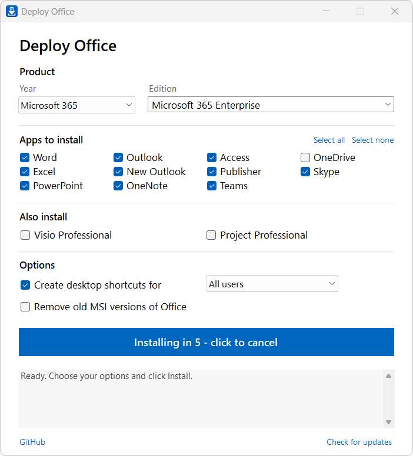


[](https://github.com/asheroto/Deploy-Office/releases)
[](https://github.com/asheroto/Deploy-Office/releases)
[](https://github.com/sponsors/asheroto?frequency=one-time&sponsor=asheroto)
<a href="https://ko-fi.com/asheroto"></a>
<a href="https://www.buymeacoffee.com/asheroto"></a>

# Deploy Office



> [!NOTE]
> Installation only starts by itself if you set `autostart=true` in `Deploy-Office.ini` or on the command line, as shown below. It then counts down for 10 seconds first, and clicking the button or changing any option cancels it.

Easily install Office 2019, 2021, 2024, or Microsoft 365. Open the program, pick your options, and click `Install`. The log shows whether the install succeeded or failed when it finishes.

Everything is downloaded from the cloud, so you'll always have the latest version available when installing.

Desktop shortcuts will also be created by default for any installed Office applications, on the Public Desktop so every user on the PC sees them. Pick **Current user only** to put them on your own Desktop instead. Office itself is always installed for all users on the PC.

Uncheck any apps you don't want (Access, Publisher, Teams, OneDrive, and so on). To install only one or two apps, click **Select none** and check just those. Tick **Visio Professional** or **Project Professional** to install them alongside Office in the same run.

If the PC has an older MSI-based Office (2016 or earlier), tick **Remove old MSI versions of Office** to uninstall it as part of the install.

## Why Use This?

Because it's a tiny executable (about 150 KB) that downloads the latest version of Office and installs it for you. No need to download the installer, write XML configuration files, or run the setup manually.

## Does This Legitimately Install Microsoft Office?

**Yes!** This is **NOT** a bootleg or modified version of Office.

As outlined in [How it Works](#how-it-works), the software fetches `setup.exe` directly from Microsoft.

Office still needs a valid license, which you can activate post-installation. Typically, after installing Office, you're given a trial period before you need to activate it.

This project and its creators are not affiliated with Microsoft. This software uses the official Office installer provided by Microsoft, which is publicly accessible.

Being open-source, the source code for this software is accessible for anyone to read and inspect.

## Legal

All rights of Microsoft Office or any of Office products listed belong to [Microsoft Corporation](https://microsoft.com).

## Supported Editions/Products

> [!NOTE]
> If you specify a calendar year like 2021, it will limit the selection to non-365 editions only.
> Similarly, specifying the calendar year `Microsoft 365` will limit the selection to only Microsoft 365 editions.
> This is a design choice to make choosing the edition simple.

### Years

1. 2019
2. 2021
3. 2024
4. Microsoft 365

### Editions/Products

1. Microsoft 365 Family/Personal
2. Microsoft 365 Small Business
3. Microsoft 365 Education
4. Microsoft 365 Enterprise
5. Home & Business
6. Home & Student
7. Personal
8. Professional
9. Professional Plus
10. Professional Plus - Volume
11. Standard
12. Standard - Volume
13. Visio Standard
14. Visio Standard - Volume
15. Visio Professional
16. Visio Professional - Volume
17. Project Standard
18. Project Standard - Volume
19. Project Professional
20. Project Professional - Volume
21. Access
22. Access - Volume
23. Excel
24. Excel - Volume
25. Outlook
26. Outlook - Volume
27. PowerPoint
28. PowerPoint - Volume
29. Publisher
30. Publisher - Volume
31. Word
32. Word - Volume

## Preset the Options and Automate the Install (Optional)

You can preset every option, and have the install start by itself, with either a `Deploy-Office.ini` file or command-line parameters.

When `Deploy-Office.exe` runs, it checks if a `Deploy-Office.ini` file exists next to it, and if so, uses its settings. Command-line parameters work the same way and are covered in [Run from the command line](#run-from-the-command-line).

### Setting up `Deploy-Office.ini`

1. **Open your favorite text editor** such as Notepad, Notepad++, or Visual Studio Code.
2. **Use the information & examples below to specify the default year/edition.** Additional options like creating shortcuts, excluding Teams, or excluding OneDrive are optional.
3. **Save the file** as `Deploy-Office.ini` in the same folder as `Deploy-Office.exe`.

### Examples

<details>
<summary>Simple example using index numbers (2021 Home & Business)</summary>

```ini
year=2
edition=5
```

- Specifies the year as **2021** (index 2).
- Specifies the edition to **Home & Business** (index 5).
- Creates **desktop shortcuts** (enabled by default).

</details>

<details>
<summary>Simple example using values (2024 Word)</summary>

```ini
year=2024
edition=Word
```

- Specifies the year as **2024**.
- Sets the edition to **Word**.
- Creates **desktop shortcuts** (enabled by default).

</details>

<details>
<summary>Detailed example using values and optional settings (Microsoft 365 Enterprise)</summary>

```ini
year=Microsoft 365
edition=Microsoft 365 Enterprise
shortcuts=true
exclude_teams=false
exclude_onedrive=true
autostart=true
```

- Specifies the year as **Microsoft 365**.
- Sets the edition to **Microsoft 365 Enterprise**.
- Creates **desktop shortcuts**.
- Installs **Microsoft Teams**.
- Excludes the installation of **OneDrive**.
- Starts installing by itself after a 10-second countdown.

</details>

<details>
<summary>Detailed example using values and optional settings (Professional Plus - Volume)</summary>

```ini
year=2024
edition=10
shortcuts=false
exclude_teams=true
exclude_onedrive=true
autostart=true
```

- Specifies the year as **2024**.
- Sets the edition to **Professional Plus - Volume**.
- Disables the creation of **desktop shortcuts**.
- Excludes the installation of **Microsoft Teams**.
- Excludes the installation of **OneDrive**.
- Starts installing by itself after a 10-second countdown.

</details>

<details>
<summary>Choosing apps and adding Visio/Project (2024 Professional Plus - Volume)</summary>

```ini
year=2024
edition=Professional Plus - Volume
exclude_apps=Access,Publisher,Skype
add_visio=true
add_project=true
shortcuts_scope=user
```

- Installs Professional Plus 2024 without Access, Publisher, or Skype for Business.
- Also installs Visio Professional 2024 and Project Professional 2024 (Volume).
- Creates desktop shortcuts for the current user only.

</details>

<details>
<summary>Fully unattended install from an RMM or script (Microsoft 365 Enterprise)</summary>

```ini
year=Microsoft 365
edition=Microsoft 365 Enterprise
exclude_apps=Teams,New Outlook
remove_msi=true
autostart=true
silent=true
```

- Installs Microsoft 365 Enterprise without Teams or the new Outlook.
- Uninstalls any MSI-based Office (2016 or earlier) first.
- Starts on launch, shows no windows, and closes when finished.
- The exit code is `0` on success. Anything else means the install failed, and `Deploy-Office.log` next to the exe says why.

</details>

### Run from the command line

Every setting in the table below can also be passed as a `name=value` parameter. Parameters use the same names as the INI and take priority over it, so you can skip the INI entirely or use it as a baseline and override one value. Put quotes around values that contain spaces.

Run it from an elevated prompt. Deploy Office always runs as administrator, so from a regular prompt Windows shows a UAC prompt first.

Command Prompt:

```bat
Deploy-Office.exe year=2024 "edition=Professional Plus - Volume" exclude_apps=Access,Publisher autostart=true silent=true
```

PowerShell:

```powershell
.\Deploy-Office.exe year=2024 "edition=Professional Plus - Volume" exclude_apps=Access,Publisher autostart=true silent=true
```

The prompt comes back right away while the install carries on. If a script needs to wait for it and read the exit code, launch it with `start /wait` (Command Prompt) or `Start-Process -Wait -PassThru` (PowerShell). The exit code is `0` when Office installed. Anything else means it failed, and `Deploy-Office.log` next to the exe says why (written automatically for silent runs, or add `log=true`).

Parameters only fill in the window. Add `autostart=true` to make it install without a click.

If a setting is mistyped (for example an edition name that does not exist), automatic start is skipped so the wrong product is never installed. The problem is shown in the window, and a silent run writes it to `Deploy-Office.log` and exits with code `1`.

### Log file

The window shows every step and any error as it happens. To also keep a record on disk, add `log=true` (in the INI or as a parameter) and each step is written to `Deploy-Office.log` in the same folder as the exe.

Runs with `silent=true` or `autoclose=true` always write the log, because the window is gone by the time you would want to read it.

### Settings

| Name               | Required | Default                    | Description                                                                                             |
| ------------------ | -------- | -------------------------- | ------------------------------------------------------------------------------------------------------- |
| `year`             | No       | Microsoft 365              | Specifies the Office version. Accepts a year (e.g., `2021`) or an index number.                         |
| `edition`          | No       | Microsoft 365 Enterprise   | Defines the Office edition to install. Accepts a name or index (e.g., `Standard`, `Professional Plus`). |
| `shortcuts`        | No       | Enabled                    | Controls whether desktop shortcuts are created. Set to `true` or `false`.                               |
| `shortcuts_scope`  | No       | `all`                      | `all` puts shortcuts on the Public Desktop (every user sees them), `user` puts them on the current user's Desktop only. |
| `exclude_apps`     | No       | None                       | Comma-separated apps to skip: `Word`, `Excel`, `PowerPoint`, `Outlook`, `OneNote`, `New Outlook` (or `OutlookForWindows`), `Access`, `Publisher`, `Teams`, `OneDrive`, `Skype` (or `Lync`). |
| `remove_msi`       | No       | Disabled                   | Set to `true` to uninstall MSI-based Office (2016 or earlier), including MSI Visio and Project, before installing. |
| `add_visio`        | No       | Disabled                   | Set to `true` to also install Visio Professional, matching the selected year and Retail/Volume type.    |
| `add_project`      | No       | Disabled                   | Set to `true` to also install Project Professional, matching the selected year and Retail/Volume type.  |
| `exclude_teams`    | No       | Disabled                   | Set to `true` to skip installing Microsoft Teams. Same as listing `Teams` in `exclude_apps`.            |
| `exclude_onedrive` | No       | Disabled                   | Set to `true` to skip installing OneDrive. Same as listing `OneDrive` in `exclude_apps`.                |
| `autostart`        | No       | Disabled                   | If set to `true`, installation starts by itself after a 10-second countdown. Click the button or change any option during the countdown to cancel. With `silent=true` it starts immediately. |
| `silent`           | No       | Disabled                   | Set to `true` to hide the Office setup window. Combined with `autostart=true`, no windows are shown at all and the program closes when finished, as if `autoclose=true` were set. |
| `autoclose`        | No       | Disabled                   | Set to `true` to close when finished. The exit code is `0` on success, or non-zero if the install failed. |
| `log`              | No       | Disabled                   | Set to `true` to write every step and error to `Deploy-Office.log` next to the exe. Always on when `silent` or `autoclose` is set, since the window is not there to read afterwards. |

Note that shortcuts will be created by default unless disabled.

## How it Works

1. If using `Deploy-Office.ini` or command-line parameters, it will set the edition/product and options to install
2. Downloads `setup.exe` from https://officecdn.microsoft.com/pr/wsus/setup.exe
3. Verifies `setup.exe` has a valid Microsoft signature, and stops if it does not
4. Extracts configuration.xml
5. Runs `setup.exe /Configure configuration.xml`
6. Reports success or failure in the window, and in `Deploy-Office.log` next to the exe when logging is on

**Note**: if you need more advanced options with your Office setup, visit [config.office.com](https://config.office.com/deploymentsettings).

## Prerequisites

- Windows 10 or later
- Server 2019 or later
- .NET Framework 4.8 (which you probably already have)
- An administrator account, or admin credentials to enter when Windows asks
- No additional dependencies needed 😊

## Download

Download the [latest version](https://github.com/asheroto/Deploy-Office/releases/latest/download/Deploy-Office.exe) in the releases section.
